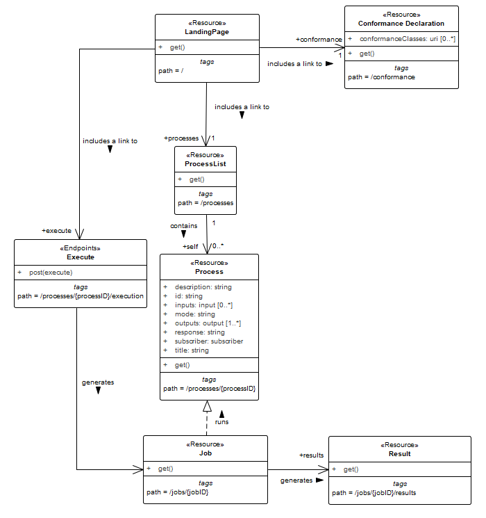

The following section describes the Core requirements class.

# Overview

<!-- requirements-class -->

A server that implements the OGC API — Processes Standard provides access to processes.

Each implementation of the OGC API — Processes Standard has a single `LandingPage` (path `/`) that provides links to:

- The `APIDefinition` (no fixed path),
- The `Conformance` statements (path `/conformance`),
- The `processes` metadata (path `/processes`).

Note that additional requirements classes may introduce additional links for inclusion in the landing page.

The `APIDefinition` describes the capabilities of the server that can be used by clients to connect to the server or by development tools to support the implementation of servers and clients. Accessing the `APIDefinition` using HTTP GET returns a description of the API deployment that includes the Processes API defined in this Standard but may include the description of additional components that are part of a broader containing API.

Accessing `Conformance` using HTTP GET returns a list of URIs of conformance classes implemented by the server.

The list of processes contains a summary of each process offered by the OGC API — Processes implementation, including the link to a more detailed description of the process.

The [process description](#sec-7.11) contains information about inputs and outputs and a link to the execution-endpoint for the process.

A HTTP POST request to the execution-endpoint creates a new job. The inputs and outputs need to be passed in a JSON execute-request.

The URL for accessing status information is delivered in the HTTP header `Location`.

After a process is finished (status = successful/failed), the results/exceptions can be retrieved.

{#img_core}

The OGC API — Processes Standard utilizes elements of the OGC API-Common Standard. [Table 7](#mapping-to-common) Identifies the API-Common Requirements Classes which are applicable to each section of this Processes API Standard.

**Table 7 — Mapping API — Processes Sections to API-Common Requirements Classes**

<div id="mapping-to-common"></div>

<table>
<tbody><tr><td><strong>API — Processes Section</strong></td><td><strong>API-Common Requirements Class</strong></td></tr><tr><td><a href="#sec-7.2">API Landing Page</a></td><td><a href="https://www.opengis.net/spec/ogcapi-common-1/1.0/req/landing-page">https://www.opengis.net/spec/ogcapi-common-1/1.0/req/landing-page</a></td></tr><tr><td><a href="#sec-7.3">API Definition</a></td><td><a href="https://www.opengis.net/spec/ogcapi-common-1/1.0/req/landing-page">https://www.opengis.net/spec/ogcapi-common-1/1.0/req/landing-page</a></td></tr><tr><td><a href="#sec-7.4">Declaration of Conformance Classes</a></td><td><a href="https://www.opengis.net/spec/ogcapi-common-1/1.0/req/landing-page">https://www.opengis.net/spec/ogcapi-common-1/1.0/req/landing-page</a></td></tr><tr><td><a href="#req-oas30-oas-definition">OpenAPI 3.0</a></td><td><a href="https://www.opengis.net/spec/ogcapi-common-1/2.0/req/oas30">https://www.opengis.net/spec/ogcapi-common-1/2.0/req/oas30</a></td></tr><tr><td><a href="#sec-10.3">HTML</a></td><td><a href="https://www.opengis.net/spec/ogcapi-common-1/2.0/req/html">https://www.opengis.net/spec/ogcapi-common-1/2.0/req/html</a></td></tr></tbody>
</table>

# Retrieve the API landing page

The following section defines the requirements to retrieve an API landing page that contains links to Processes API resources but may also contain links to resources that are part of a broader, containing, API.

## Operation

<!-- requirement: core/landingpage-op -->

## Response

<!-- requirement: core/landingpage-success -->

**NOTE 1:** The term “*…based upon the OpenAPI 3.0 schema…*” used in requirements specified in this Standard means that OpenAPI 3.0 is used to define:

- All the required properties of the respective request/response schema,
- Any optional properties of the respective request/response schema.

Unless explicitly excluded, these OpenAPI schemas are extensible with additional properties not defined in the schema using the [`additionalProperties`](https://github.com/OAI/OpenAPI-Specification/blob/main/versions/3.0.0.md#schemaObject) mechanism defined in the [OpenAPI 3.0 specification](https://github.com/OAI/OpenAPI-Specification/blob/main/versions/3.0.0.md).

```yaml
type: object
required:
  - links
properties:
  title:
    type: string
    example: Example processing server
  description:
    type: string
    example: Example server implementing the OGC API - Processes 1.0 Standard
  attribution:
    type: string
    title: attribution for the Processes API
    description: The `attribution` should be short and intended for presentation to a user, for example, in a corner of a map. Parts of the text can be links to other resources if additional information is needed. The string can include HTML markup.
  links:
    type: array
    items:
      $ref: 'link.yaml'
```

**Listing 1 — Schema for the landing page**

**NOTE 2:** This schema can also be obtained from [`landingPage.yaml`](https://raw.githubusercontent.com/opengeospatial/ogcapi-processes/master/openapi/schemas/common-core/landingPage.yaml).

<div id="link-schema"></div>

```yaml
type: object
required:
  - href
properties:
  href:
    type: string
  rel:
    type: string
    example: service
  type:
    type: string
    example: application/json
  hreflang:
    type: string
    example: en
  title:
    type: string
```

**Listing 2 — Schema for a link**

**NOTE 3:** This schema can also be obtained from [`link.yaml`](https://raw.githubusercontent.com/opengeospatial/ogcapi-processes/master/openapi/schemas/common-core/link.yaml).

**Example — Landing page response document**

```json
{
  "links": [{
    "href": "http://processing.example.org/oapi-p?f=application/json",
    "rel": "self",
    "type": "application/json",
    "title": "This document"
  },{
    "href": "http://processing.example.org/oapi-p?f=text/html",
    "rel": "alternate",
    "type": "text/html",
    "title": "This document as HTML"
  },
  {
    "href": "http://processing.example.org/oapi-p/api?f=application/json",
    "rel": "service-desc",
    "type": "application/json",
    "title": "API definition for this endpoint as JSON"
  },
  {
    "href": "http://processing.example.org/oapi-p/api?f=text/html",
    "rel": "service-desc",
    "type": "text/html",
    "title": "API definition for this endpoint as HTML"
  },
  {
    "href": "http://processing.example.org/oapi-p/conformance",
    "rel": "http://www.opengis.net/def/rel/ogc/1.0/conformance",
    "type": "application/json",
    "title": "OGC API - Processes conformance classes implemented by this server"
  },
  {
    "href": "http://processing.example.org/oapi-p/processes",
    "rel": "http://www.opengis.net/def/rel/ogc/1.0/processes",
    "type": "application/json",
    "title": "Metadata about the processes"
  },
  {
    "href": "http://processing.example.org/oapi-p/jobs",
    "rel": "http://www.opengis.net/def/rel/ogc/1.0/job-list",
    "title": "The endpoint for job monitoring"
  }]
}
```

## Error situations

See [[http_status_codes]](#sec-7.5.1) for general guidance.

# Retrieve an API definition

The following section defines the requirements to retrieve an API definition. This API may only implement components of the Processes API defined in this Standard but may define the implementation of a broader API deployment into which the Processes API is embedded.

## Operation

Every implementation of OGC API — Processes must provide metadata that describes the functional capabilities of the server instance that the API definition provides access to. In this document, this is known as the “API definition”. This definition is used by developers to understand the functionality provided by the API endpoint, so software clients can connect to the server, or by development tools to support the implementation of servers and clients.

<!-- requirement: core/api-definition-op -->

<!-- permission: core/api-definition-uri -->

Note that multiple API definition formats can be supported.

## Response

<!-- requirement: core/api-definition-success -->

<!-- recommendation: core/api-definition-oas -->

If multiple API definition formats are supported by a server, use content negotiation to select the desired representation.

**NOTE:** Common approaches include:

- Standard HTTP content negotiation using the HTTP header `Accept`;
- An additional path for each encoding of each resource (this can be expressed, for example, using format specific suffixes like “.html”);
- An additional query parameter (for example, “accept” or “f”) that overrides the Accept header of the HTTP request.

The API definition document describes the API implementation instance. In other words, there is no need to include the `/api` operation in the API definition itself.

The idea is that any implementation of OGC API — Processes can be used by developers that are familiar with the API definition language(s) supported by the server. For example, if an OpenAPI definition is used, it should be possible to create the skeleton of a working client using the OpenAPI definition alone.

## Error situations

See [[http_status_codes]](#sec-7.5.1) for general guidance.

# Declaration of conformance classes

## Operation

To support “generic” clients for accessing servers implementing OGC API — Processes in general — and not “just” a specific API / server, the server must declare the requirements classes it implements and conforms to.

<!-- requirement: core/conformance-op -->

## Response

<!-- requirement: core/conformance-success -->

```yaml
type: object
required:
  - conformsTo
properties:
  conformsTo:
    type: array
    items:
      type: string
      example: "http://www.opengis.net/spec/ogcapi-processes-1/1.0/conf/core"
```

**Listing 3 — Schema for the list of requirements classes**

**NOTE:** This schema can also be obtained from [`confClasses.yaml`](https://raw.githubusercontent.com/opengeospatial/ogcapi-processes/master/openapi/schemas/common-core/confClasses.yaml).

**Example — Requirements class response document**

This example response in JSON is for a server that supports OpenAPI 3.0 for the API definition and HTML and JSON as encodings.

```json
{
  "conformsTo": [
    "http://www.opengis.net/spec/ogcapi-processes-1/2.0/conf/core",
    "http://www.opengis.net/spec/ogcapi-processes-1/2.0/conf/json",
    "http://www.opengis.net/spec/ogcapi-processes-1/2.0/conf/html",
    "http://www.opengis.net/spec/ogcapi-processes-1/2.0/conf/oas30"
  ]
}
```

## Error situations

See [[http_status_codes]](#sec-7.5.1) for general guidance.

# Use of HTTP 1.1

<!-- requirement: core/http -->

This includes the correct use of status codes, headers. etc.

<!-- recommendation: core/http-head -->

Supporting the HEAD method, in addition to GET, is simple and can provide useful information such as the size of a potential response without needing to transmit the entire content of the response beforehand.

<!-- recommendation: core/content-length -->

Servers implementing [Cross-Origin Resource Sharing (CORS)](https://docs.ogc.org/DRAFTS/17-069r4.html#cross_origin) will also implement the OPTIONS method.

## HTTP status codes

[Table 8](#status_codes) lists the main HTTP status codes that clients should be prepared to receive.

This includes, for example, support for specific security schemes or URI redirection.

In addition, other error situations may occur in the transport layer outside of the server.

**Table 8 — Typical HTTP status codes**

<div id="status_codes"></div>

| Status code | Description |
|---|---|
| `200` | A successful request. |
| `201` | The request was successful and one or more new resources have been created. |
| `204` | The request was successful but did not generate any content. |
| `400` | The server cannot or will not process the request due to an apparent client error. For example, a query parameter had an incorrect value. |
| `401` | The request requires user authentication. The response includes a<br>`WWW-Authenticate`<br>header field containing a challenge applicable to the requested resource. |
| `403` | The server understood the request but is refusing to fulfill it. While status code<br>`401`<br>indicates missing or bad authentication, status code<br>`403`<br>indicates that authentication is not the issue, but the client is not authorized to perform the requested operation on the resource. |
| `404` | The requested resource does not exist on the server. For example, a path parameter had an incorrect value. |
| `405` | The request method is not supported. For example, a POST request was submitted, but the resource only supports GET requests. |
| `406` | The<br>`Accept`<br>header submitted in the request did not support any of the media types supported by the server for the requested resource. |
| `410` | The target resource is no longer available at the origin server. |
| `429` | The user has sent too many requests in a given amount of time (“rate limiting”). |
| `500` | An internal error occurred in the server. |
| `501` | The server does not support the functionality required to fulfill the request. |

More specific guidance is provided for each resource, where applicable.

<!-- permission: core/additional-status-codes -->

When a server encounters an error in the processing of a request, it may wish to include information in addition to the status code in the response. Since Web API interactions are often machine-to-machine, a machine-readable report would be preferred. [RFC 9457](https://datatracker.ietf.org/doc/html/rfc9457) addresses this need by providing “Problem Details” response schemas for both JSON and XML.

<!-- recommendation: core/problem-details -->

# Support for cross-origin requests

If the content is located on another host that the webpage (“same-origin policy”) access to content from that HTML page is by default prohibited for security reasons. Cross-origin resource sharing is a mechanism that allows restricted resources on a web page to be requested from another domain outside the domain from which the first resource was served. A typical example is a web-application accessing processes and data from multiple servers.

<!-- recommendation: core/cross-origin -->

Two common mechanisms to support cross-origin requests are:

- [Cross-origin resource sharing (CORS)](https://en.wikipedia.org/wiki/Cross-origin_resource_sharing)
- [JSONP (JSON with padding)](https://en.wikipedia.org/wiki/JSONP)

<!-- recommendation: core/access-control-expose-headers -->

<!-- recommendation: core/html -->

# Content negotiation by profile

The use of generic media types such as `application/json` makes it difficult to request or identify different flavors or profiles of a resource. For example, the media type `application/json` could be used to describe an [OGC process description document](#sec-9) as well as an [OpenEO process description document](https://documentation.dataspace.copernicus.eu/APIs/openEO/Processes.html).

Therefore, a mechanism for requesting a profile of a resource would be useful. Although there is a new HTTP header, `Accept-Profile`, that is to be defined in an upcoming [Internet-Draft](https://profilenegotiation.github.io/I-D-Profile-Negotiation/I-D-Profile-Negotiation), there is currently no standardized way to request a profile of a resource. Existing standards, however, do provide mechanisms for specifying profile information in HTTP headers. Specifically (see [Content Negotiation by Profile](https://www.w3.org/TR/dx-prof-conneg/#bib-prof-ietf)) profiles of a resource may be requested by:

- Using the `profile` parameter if the media type includes provisions for such a parameter (e.g. [`application/ld+json profile=http://www.w3.org/ns/json-ld#context`](https://www.iana.org/assignments/media-types/application/ld+json)),
- Using the `Accept-Profile` header if the intended media type does not include provisions for a `profile` parameter and can, thus, not be specified in the `Accept` header,
- Using the `profile` parameter with the [HTTP `Prefer` header](https://www.rfc-editor.org/rfc/rfc7240),
- Specified the `Link` header with `rel="profile"` in the request headers.

This Standard also defines a query parameter [`profile`](#sec-17), that may be used with an HTTP GET request to specify one or more profiles of a resource that are to be retrieved.

When a content negotiation by *profile* is performed using one of the above mechanisms, the following response headers should be returned:

- The `Preference-Applied` header with the `profile` parameter should be returned if content negotiation was performed using the `Prefer` header,
- The `Content-Type` header with `profile` parameter should be returned if content negotiation was performed using the `Accept` header with a media type including `profile` provisions.

In all cases of content negotiation by profile, one or more `Link` (`rel="profile"`) headers indicating the profiles applied should be returned in the response if there is a corresponding URI identifier defined for the profile(s) that can be included as the `href` of the link.

**NOTE 1:** This is not always the case (e.g. `image/tiff; application=geotiff; profile=cloud-optimized`). In such cases, the other the other headers (`Preference-Applied` and `Content-Type`) containing a `profile` parameter may be relevant.

**NOTE 2:** A set of profile URIs for JSON content defined in this Standard can be found in the [Profile identifiers](#profile-uris) table.

# Limit query parameter

Several resources defined in this Standard (see [Retrieve a process list](#sec-7.10), [Retrieve a job list](#sec-12.2.1)) use the `limit` query parameter to control the maximum number of results that are presented in a response page.

- The client can request a limit it is interested in.
- The server likely has a default value for the limit, and a maximum limit.
- If the server has any more results available than it returns (the number it returns is less than or equal to the requested/default/maximum limit) then the server will include a link to the next set of results.

As an example, using the default/maximum values of 10/1000 from the OpenAPI fragment in requirement [`/req/core/pl-limit-definition`](#req-core-pl-limit-definition) or [`/req/job-list/limit-definition`](#req-job-list-limit-definition):

- If the client asks for 10 results, the client will get 0 to 10 (as requested) and if there are more, a `next` link;
- If the client does not specify a limit, the client will get 0 to 10 (default) and if there are more, a `next` link;
- If the client asks for 5000 results, the client might get up to 1000 results (server-limited) and if there are more, a `next` link;
- If the client follows the next link from the previous response, the client might get up to 1000 additional results and if there are more, a `next` link.

This Standard provides requirements and recommendations about links in general and the `next` link in particular at the appropriate resource end points.

<span id="next-link-discussion"></span>This Standard does not mandate any specific implementation approach for the `next` links.

An implementation of the Processes API could use opaque links that are managed by the server. It is up to the server to determine how long these links can be dereferenced. Clients should be prepared to receive a 404 or 410 response.

Another implementation approach is to use an implementation-specific parameter that specifies the index within the result set from which the server begins presenting results in the response, like `offset` or the `startIndex` parameter that was used in [WFS 2.0](#WFS20).

If all selected results have been returned, an implementation of the Processes API will note return a `next` link, and as such the server knows for certain that there are no further results to be presented. However, in some cases, the server may not be aware that it has already returned all selected results. For example, if the request states `limit=10` and the query to the backend returns exactly 10 results. Unless the total number results is also computed the server may not know if there are more results or not (in most cases there will be more results). However such a computation may be too costly. The server will then prudently add the `next` link, and if there are no more results, dereferencing the next link will return an empty results list and no `next` link. This behavior is consistent with the statements above.

Clients should not assume that paging is safe against changes to the dataset being accessed while a client iterates through `next` links. If a server provides opaque links, these could be safe and maintain the state during the original request. Using a parameter for the start index, however, will not be safe.

<span id="prev-link-discussion"></span>This Standard also has recommendations about including a `prev` link at the appropriate resource end points. Providing `prev` links supports navigating back and forth between pages, but depending on the implementation approach, it may be too complex to implement.

# Link headers

<!-- recommendation: core/link-header -->

# Retrieve a process list

The following section defines the requirements to retrieve the available processes offered by an implementation of the Processes API.

It should be noted that the number of processes exposed via the Processes API may be very different from the number of processes offered by a back-end system upon which the Processes API is implemented.

## Operation

### Process list

<!-- requirement: core/process-list-op -->

### Query parameter limit

<!-- requirement: core/pl-limit-definition -->

<!-- permission: core/limit-default-minimum-maximum -->

<!-- requirement: core/pl-limit-response -->

<!-- permission: core/limit-response -->

## Response

<!-- requirement: core/process-list-success -->

```yaml
type: object
required:
  - processes
  - links
properties:
  processes:
    type: array
    items:
      $ref: "processSummary.yaml"
  links:
    type: array
    items:
      $ref: "link.yaml"
```

**Listing 5 — Schema for the process list**

**NOTE 1:** This schema can also be obtained from [`processList.yaml`](https://raw.githubusercontent.com/opengeospatial/ogcapi-processes/master/openapi/schemas/processes-core/processList.yaml).

<div id="schema-processSummary"></div>

```yaml
allOf:
  - $ref: "descriptionType.yaml"
  - type: object
    required:
      - id
      - version
    properties:
      id:
        type: string
      version:
        type: string
      jobControlOptions:
        type: array
        items:
          $ref: "jobControlOptions.yaml"
      links:
        type: array
        items:
          $ref: "link.yaml"
```

**Listing 6 — Schema for a process summary**

**NOTE 2:** This schema can also be obtained from [`processSummary.yaml`](https://raw.githubusercontent.com/opengeospatial/ogcapi-processes/master/openapi/schemas/processes-core/processSummary.yaml).

(see also: [`descriptionType.yaml`](https://raw.githubusercontent.com/opengeospatial/ogcapi-processes/master/openapi/schemas/processes-core/descriptionType.yaml)).

```yaml
type: string
enum:
  - sync-execute
  - async-execute
  - dismiss
```

**Listing 7 — Schema for the job control options**

**NOTE 3:** This schema can also be obtained from [`jobControlOptions.yaml`](https://raw.githubusercontent.com/opengeospatial/ogcapi-processes/master/openapi/schemas/processes-core/jobControlOptions.yaml).

The number of process summaries returned depends on the server and the parameter `limit.`

See the discussion about the `limit` query parameter in the [Limit query parameter](#sec-7.8) section.

<!-- requirement: core/pl-links -->

<!-- requirement: core/process-summary-links -->

See the discussion about the `next` links in the [Limit query parameter](#next-link-discussion) section.

<!-- recommendation: core/next-1 -->

<!-- recommendation: core/next-2 -->

<!-- recommendation: core/next-3 -->

See the discussion about the `prev` link in the [Limit query parameter](#prev-link-discussion) section.

<!-- permission: core/prev -->

**Example 1 — A HTTP GET request for retrieving the list of offered processes encoded as JSON.**

```http
GET /processes HTTP/1.1
Host: processing.example.org
```

**Example 2 — A Process list encoded as JSON.**

```json
{
  "processes": [
    {
      "id": "EchoProcess",
      "title": "EchoProcess",
      "version": "1.0.0",
      "jobControlOptions": [
        "async-execute",
        "sync-execute"
      ],
      "links": [
        {
          "href": "https://processing.example.org/oapi-p/processes/EchoProcess",
          "type": "application/json",
          "rel": "self",
          "title": "process description"
        }
      ]
    }
  ],
  "links": [
    {
      "href": "https://processing.example.org/oapi-p/processes?f=json",
      "rel": "self",
      "type": "application/json"
    },
    {
      "href": "https://processing.example.org/oapi-p/processes?f=html",
      "rel": "alternate",
      "type": "text/html"
    }
  ]
}
```

## Error situations

See [[http_status_codes]](#sec-7.5.1) for general guidance.

# Retrieve a process description

The following section defines the requirements to retrieve metadata about a process.

## Operation

<!-- requirement: core/process-description-op -->

## Response

<!-- requirement: core/process-description-success -->

The [Core](#bb-ogc-api-processes-part1-v2-requirements-core) does not mandate the use of a specific process description to specify the interface of a process. That said, the [Core](#bb-ogc-api-processes-part1-v2-requirements-core) requirements class makes the following recommendation:

<!-- recommendation: core/ogc-process-description -->

<!-- recommendation: core/header-profile-link -->

## Error situations

See [[http_status_codes]](#sec-7.5.1) for general guidance.

<!-- requirement: core/process-exception-no-such-process -->

<!-- permission: core/process-exception-process-gone -->

# Execute a process

This section describes the requirements for executing a process.

Depending on the description of the [process](#sec-7.11) and the [negotiated process execution mode](#sec-7.12.2.2), process execution may result in the creation of a [job resource](#sec-7.14).

## Operation

<!-- requirement: core/process-execute-op -->

## Request body

### Content schema

<!-- requirement: core/process-execute-request -->

<div id="execute-request-body"></div>

```yaml
allOf:
  - type: object
    properties:
      process:
        type: string
        format: uri
        description: The URI to the description of the process that should be executed.
  - $ref: "responseCollection.yaml"
  - $ref: "executeBase.yaml"
```

**Listing 8 — Schema for execute**

```yaml
type: object
properties:
  inputs:
    additionalProperties:
      $ref: "values.yaml"
  outputs:
    additionalProperties:
      $ref: "outputSelection.yaml"
  subscriber:
    $ref: "subscriber.yaml"
```

**Listing 9 — Schema for execute base parameters**

**NOTE 1:** This schema can also be obtained from [`execute.yaml`](https://raw.githubusercontent.com/opengeospatial/ogcapi-processes/master/openapi/schemas/processes-core/execute.yaml).

<div id="inline-or-ref-value"></div>

```yaml
oneOf:
  - $ref: "valueNoObject.yaml"
  - $ref: "qualifiedValue.yaml"
  - $ref: "link.yaml"
```

**Listing 10 — Schema for an in-line or referenced process input value**

**NOTE 2:** This schema can also be obtained from [`inlineOrRefValue.yaml`](https://raw.githubusercontent.com/opengeospatial/ogcapi-processes/master/openapi/schemas/processes-core/inlineOrRefValue.yaml).

(see also: [valueNoObject.yaml](#value-noobject-schema), [qualifiedValue.yaml](#qualified-value-schema), [link.yaml](#link-schema))

<div id="output-schema"></div>

```yaml
type: object
properties:
  format:
    $ref: "format.yaml"
```

**Listing 11 — Schema for a process output**

**NOTE 3:** This schema can also be obtained from [`output.yaml`](https://raw.githubusercontent.com/opengeospatial/ogcapi-processes/master/openapi/schemas/processes-core/output.yaml).

<div id="format-schema"></div>

```yaml
# anything included here is automatically inherited by the qualified value, collection and output selection 'format'
allOf:
  - type: object
    properties:
      mediaType:
        type: string
      encoding:
        type: string
      schema:
        oneOf:
          - type: string
            format: url
          - type: object
  - $ref: "dataClasses.yaml"
```

**Listing 12 — Schema for a format qualifier**

**NOTE 4:** This schema can also be obtained from [`format.yaml`](https://raw.githubusercontent.com/opengeospatial/ogcapi-processes/master/openapi/schemas/processes-core/format.yaml).

### Execution mode

A process may be executed synchronously or asynchronously.

Which mode a server responds with is a function of the job control options specified in the [process description](#sec-7.11) and the presence or absence of the HTTP `Prefer` header ([IETF RFC 7240](https://tools.ietf.org/rfc/rfc7240.txt)).

<!-- requirement: core/process-execute-default-execution-mode -->

<!-- requirement: core/process-execute-auto-execution-mode -->

<!-- recommendation: core/process-execute-honor-prefer -->

**NOTE:** A client that accompanies an [execute request](#execute-request-body) with the HTTP [`Prefer`](https://datatracker.ietf.org/doc/html/rfc7240#section-2) header asserting a [`respond-async`](https://tools.ietf.org/html/rfc7240#section-4.1) preference and/or a [`wait`](https://tools.ietf.org/html/rfc7240#section-4.3) preference SHOULD be prepared to receive either an asynchronous or a synchronous response.

<!-- recommendation: core/process-execute-preference-applied -->

### Process inputs

#### Overview

Each process input is a name/value pair that appears in the `inputs` section of an [execute request](#execute-request-body) as show in the following example:

```json
{
  "inputs": {
     "inputName1": "<input value 1>",
     "inputName2": "<input value 2>",
     ...
  }
}
```

**Listing 13**

The actual name of each input is its identifier as specified by the input’s definition in the [process description](#sec-7.11).

#### Input values

As shown in [inlineOrRefValue.yaml](https://raw.githubusercontent.com/opengeospatial/ogcapi-processes/master/openapi/schemas/processes-core/inlineOrRefValue.yaml), a process input value that is specified in-line in an [execute request](#execute-request-body) can be:

- a [simple literal value](#simple-literals),

- an [array](#arrays),

- a [qualified value](#qualified-value),

- a [binary value](#binary-value),

- or a [bounding box](#bounding-box-value).

  **NOTE 1:** See also [Clause 8.1](#sec-8.1).

<span id="simple-literals"></span>***Simple literal values:***

A simple literal value can be a string, number, integer or Boolean.

<div id="value-noobject-schema"></div>

```yaml
anyOf:
  - type: string
  - type: number
  - type: integer
  - type: boolean
  - type: array
    items: { }
  - $ref: "binaryValue.yaml"
  - $ref: "bbox.yaml"
  - $ref: "collectionValue.yaml"
```

**Listing 14 — Schema for a simple literal value**

**NOTE 2:** This schema can also be obtained from [`valueNoObject.yaml`](https://raw.githubusercontent.com/opengeospatial/ogcapi-processes/master/openapi/schemas/processes-core/valueNoObject.yaml).

(see also: [binaryValue.yaml](#binary-input-value-schema), [bbox.yaml](#bbox-schema))

**Example 1 — Simple literal value examples.**

A string literal:

```json
{"stringInput": "String value"}
```

A date string:

```json
{"dateInput": "2021-05-24T20:40:13-05:00"}
```

A number:

```json
{"numberInput": 3.14159}
```

An integer:

```json
{"integerInput": 10}
```

A Boolean:

```json
{"booleanInput": true}
```

<span id="arrays"></span>***Array of values:***

Array elements, as per [inlineOrRefValue.yaml](#inline-or-ref-value), can be:

- [simple literals](#simple-literals),
- embedded arrays,
- [qualified values](#qualified-value),
- [binary values](#binary-value),
- [bounding box values](#bounding-box-value),
- or references to values using [links](#link-schema).

<!-- requirement: core/process-execute-input-array -->

**Example 2 — Array value examples.**

An array of simple values:

```json
{
  "arrayOfSimpleValues": [1, 2, 4, 10, 7]
}
```

An array with a single simple value:

```json
{
  "arrayOfSimpleValues": ["a"]
}
```

An array of arrays of simple values:

```json
{
  "arrayOfArrays": [[1,2,3,4], ["a","b","c","d"]]
}
```

An array of objects values:

```json
{
  "arrayOfQualifiedValues": [
    {
      "value": {
        "measurement": 10.3,
        "uom": "m",
        "reference": "https://ucum.org/ucum-essence.xml"
      }
    },
    {
      "value": {
        "measurement": 10.5,
        "uom": "m",
        "reference": "https://ucum.org/ucum-essence.xml"
      }
    },
    {
      "value": {
        "measurement": 10.9,
        "uom": "m",
        "reference": "https://ucum.org/ucum-essence.xml"
      }
    },
    ...
  ]
}
```

**NOTE 3:** In an [execute request](#execute-request-body), as per requirement [/req/core/process-execute-input-inline-object](#req-core-process-execute-input-inline-object), object values must be encoded as [qualified values](#qualified-value).

<span id="qualified-value"></span>***Qualified values:***

A qualified value is a [value](#input-value-schema) that can be optionally qualified with a `format` parameter.

Qualified values can be used to encode process input values that, according to their definition in the [process description](#sec-7.11), can be of multiple media types. The `format` parameter is used to identify the specific media type being provided as the process input.

Qualified values can also be used to encode object-valued process inputs in order to avoid ambiguity with the built-in value schemas defined in this Standard (i.e. [bbox.yaml](#bounding-box-value), [link.yaml](#link-schema) or [qualifiedValue.yaml](#qualified-value) itself).

The actual *value* in a qualified value object is specified using the `value` key. The value of the `value` key is an instance of [value.yaml](#input-value-schema).

<div id="qualified-value-schema"></div>

```yaml
allOf:
  - $ref: "format.yaml"
  - $ref: "dataClasses.yaml"
  - type: object
    required:
      - value
    properties:
      value:
        $ref: "value.yaml"
```

**Listing 15 — Schema for a qualified value**

**NOTE 4:** This schema can also be obtained from [`qualifiedValue.yaml`](https://raw.githubusercontent.com/opengeospatial/ogcapi-processes/master/openapi/schemas/processes-core/qualifiedValue.yaml).

(see also: [format.yaml](#format-schema))

<div id="input-value-schema"></div>

```yaml
anyOf:
  - $ref: "valueNoObject.yaml"
  - type: object
```

**Listing 16 — Schema of a process input value**

**NOTE 5:** This schema can also be obtained from [`value.yaml`](https://raw.githubusercontent.com/opengeospatial/ogcapi-processes/master/openapi/schemas/processes-core/value.yaml).

(see also: [valueNoObject.yaml](#value-noobject-schema))

<!-- requirement: core/process-execute-input-inline-object -->

<!-- requirement: core/process-execute-input-multiple-types -->

**Example 3 — Qualified value examples.**

An example of a complex process input value.

```yaml
"complexObjectInput": {
  "value": {
    "property1": "value1",
    "property2": "value2",
    "property3": "value3"
  }
}
```

In this second example, the property `geometryInput` has a cardinality of greater than 1 and value instances can be one of a number of enumerated media types. The schema of `geometryInput` from the [OGC process description](#sec-9) for the process might be:

```json
{
  "geometryInput": {
    "title": "Geometry input",
    "description": "This is an example of a geometry input.  In this case the geometry can be expressed as a GML or GeoJSON geometry.",
    "minOccurs": 2,
    "maxOccurs": 5,
    "schema": {
      "oneOf": [
        {
          "type": "string",
          "contentMediaType": "application/gml+xml; version=3.2",
          "contentSchema": "https://schemas.opengis.net/gml/3.2.1/geometryBasic2d.xsd"
        },
        {
          "$ref": "https://schemas.opengis.net/ogcapi/features/part1/1.0/openapi/schemas/geometryGeoJSON.json"
        }
      ]
    }
  }
}
```

and an instance of this process input in an [execute request](#execute-request-body) might be:

```json
{
  "geometryInputs": [
    {
      "value": "<gml:Polygon gml:id=\"GID1\" srsName=\"urn:ogc:def:crs:OGC::CRS84\"><gml:exterior><gml:LinearRing><gml:posList>-77.024519 38.810529 -77.024635 38.810973 -77.024704 38.810962 -77.024776 38.811239 -77.024957 38.81121 -77.024905 38.811012 -77.024905 38.811012 -77.024865 38.810857 -77.025024 38.810832 -77.025071 38.811012 -77.025203 38.810992 -77.02506 38.810444 -77.024519 38.810529</gml:posList></gml:LinearRing></gml:exterior></gml:Polygon>",
      "mediaType": "application/gml+xml; version=3.2"
    },
    {
      "value": {
        "type": "Polygon",
        "coordinates": [[[ -176.5814819, -44.10896301 ],
                         [ -176.5818024, -44.10964584 ],
                         [ -176.5844116, -44.11236572 ],
                         [ -176.5935974, -44.11021805 ],
                         [ -176.5973511, -44.10743332 ],
                         [ -176.5950928, -44.10562134 ],
                         [ -176.5858459, -44.1043396  ],
                         [ -176.5811157, -44.10667801 ],
                         [ -176.5814819, -44.10896301 ]]]
      },
      "mediaType": "application/geo+json"
    }
  ]
}
```

In this case, the `mediaType` parameter is used to indicate the specific type of geometry being passed as input in each case: GML Polygon for the first element of the array and GeoJSON Polygon for the second element.

<span id="binary-value"></span>***Binary values:***

In some cases, for example to pass through firewalls, binary input values need to be encoded in-line in an [execute request](#execute-request-body) as a string.

<div id="binary-input-value-schema"></div>

```yaml
type: string
# contentEncoding: base64
```

**Listing 17 — Schema for an in-line binary value**

**NOTE 6:** This schema can also be obtained from [`binaryValue.yaml`](https://raw.githubusercontent.com/opengeospatial/ogcapi-processes/master/openapi/schemas/processes-core/binaryValue.yaml).

<!-- requirement: core/process-execute-input-inline-binary -->

**Example 4 — Binary value examples.**

Below is an example of an image process input whose media type is defined in the [process description](#sec-7.11). The schema definition for this process input might be:

```json
{
  "schema": {
    "type": "string",
    "contentEncoding": "binary",
    "contentMediaType": "image/tiff; application=geotiff"
  }
}
```

and an example instance value in an [execute request](#execute-request-body) might be:

```json
{
  "imageInput": "R0lGODdhNAHCAfcAAAcHDD+Gs4sLDQpDaqGFdaHE54dJPEoECUlGRteKgcdITgokG4hoVkpY\ngNzHwKKkqOLm7RRjlEgpHU9iZ44lHQYqVdmki6doVmhHOMOIeJG20HiDjCcKBglIeadISrso\nJGooFNbN2d2qr8aljyklHwQJQkdvkWaKxIdrb442LidLeGhMTp6LkeP1+Kh3aiUuVAoUHmlu\ngkcwNYdZRmkJDYGcsDFokElVYyk1NsWWhLEPDtmQldrUyoyFhrjo+Nna5d+4tMGstspoXgc4\n...qgu7sSu7qbtCs2u7t6u6rLsrp4u7veu76eO6vyu8w0u8xWu8x4u8yau8shu8y+u8zwu90Su9\n00u91Wu914u92au928u9whsQADs="
}
```

**NOTE 7:** Even though the schema indicates that the input type is `binary`, when the input value is encoded in-line in an [execute request](#execute-request-body), as per requirement [/req/core/process-execute-input-inline-binary](#req-core-process-execute-input-inline-binary), the binary value is encoded as base64-encoded string.

In this second example, the image input can be one of a number of value types denoted in JSON Schema by the use of the `oneOf[]` construct. An example schema for this process input might be:

```json
{
  "schema": {
    "oneOf": [
      {
        "type": "string",
        "contentEncoding": "binary",
        "contentMediaType": "image/tiff; application=geotiff"
      },
      {
        "type": "string",
        "contentEncoding": "binary",
        "contentMediaType": "image/jp2"
      }
    ]
  }
}
```

and a JPEG2000 instance example in an [execute request](#execute-request-body) might be:

```json
{
  "value": "VBORw0KGgoAAAANSUhEUgAABvwAAAa4CAYAAABMB35kAAABhGlDQ1BJQ0MgcHJvZmlsZQAA\nKJF9kT1Iw0AcxV9TpSL1A+xQxCFDdbIgKuKoVShChVArtOpgcumH0KQhSXFxFFwLDn4sVh1c\nnHV1cBUEwQ8QNzcnRRcp8X9JoUWMB8f9eHfvcfcOEOplplkdY4Cm22Y6mRCzuRUx9IogouhH\n ... \nj3Z5mX7/PCPVRJV92rpHK24xcJrzk20+tkeYlCPqcZNO3Lpni1OJWatPCcmgGDEqx7Om6lfa\nppM4k4BTe9+bsn3L9/9/yWhA0PwQGW8ipCZsnZt9lsdrYEM8z/M8z/M8z/M8z/M8z/MzLWY1\nAAAACUlEQVQ871H6P6JI+TxS5Wn2AAAAAElFTkSuQmCC",
  "mediaType": "image/jp2"
}
```

<span id="bounding-box-value"></span>***Bounding box values:***

A process input value instance can be a bounding box.

<!-- requirement: core/process-execute-input-inline-bbox -->

<div id="bbox-schema"></div>

```yaml
type: object
required:
  - bbox
properties:
  bbox:
    type: array
    oneOf:
      - minItems: 4
        maxItems: 4
      - minItems: 6
        maxItems: 6
    items:
      type: number
  crs:
    $ref: "bbox-def-crs.yaml"
```

**Listing 18 — Schema for a bounding box value**

**NOTE 8:** This schema can also be obtained from [`bbox.yaml`](https://raw.githubusercontent.com/opengeospatial/ogcapi-processes/master/openapi/schemas/processes-core/bbox.yaml).

This schema is meant to be a template for defining bounding box process inputs. If the specified `default` and `enum` are suitable for the client’s requirements, then this file can be referenced directly in the process description.

<!-- permission: core/process-execute-input-inline-bbox -->

**NOTE 9:** The `crs` property is defined using an `anyOf` of either an enumeration or a generic URI string to allow [execute requests](#execute-request-body) making use of a CRS other than CRS84 and CRS84h. These may be supported by the server to validate against the canonical OGC schema.

***Input validation***

Process inputs in an [execute request](#execute-request-body) and the corresponding process input definition in the [process description](#sec-7.11) have a validation relationship. That is to say, the schema of a process input definition from the [process description](#sec-7.11) can be used to validate the component of the corresponding process input value in an [execute request](#execute-request-body) that is an instance of [value.yaml](#input-value-schema).

****

Consider a process input named `complexObjectInput` with the following definition from an [OGC process description](#sec-9):

```json
{
  "complexObjectInput": {
    "title": "Complex Object Input Example",
    "description": "This is an example of a complex object input.",
    "schema": {
      "type": "object",
      "required": [
        "property1",
        "property5"
      ],
      "properties": {
        "property1": {
          "type": "string"
        },
        "property2": {
          "type": "string",
          "format": "uri"
        },
        "property3": {
          "type": "number"
        },
        "property4": {
          "type": "string",
          "format": "date-time"
        },
        "property5": {
          "type": "boolean"
        }
      }
    }
  }
}
```

and the following instance in an [execute request](#execute-request-body):

```json
{
  "inputs": [
    ...
    "complexObjectInput": {
      "value": {
        "property1": "value1",
        "property2": "value2",
        "property3": "value5"
      }
    },
    ...
  ]
}
```

The process input value in this [execute request](#execute-request-body) is an instance of a [qualified value](#qualified-value).

For the purposes of validation, the server needs to only validate the component of the [qualified value](#qualified-value) that is an instance of [value.yaml](#input-value-schema) against the `schema` fragment from the [OGC process description](#sec-9). Specifically, the validation target is:

```json
{
  "property1": "value1",
  "property2": "value2",
  "property3": "value5"
}
```

**NOTE 10:** This example makes use of an [OGC process description](#sec-9). However, any other process description vocabulary may be used and applied, for the purpose of validation, in a similar manner.

<!-- requirement: core/process-execute-input-validation -->

### Process outputs

***Overview:***

Each process output is a named object that appears in the `outputs` section of an [execute request](#execute-request-body). The name of each output is its identifier as specified by the output’s definition in the [process description](#sec-7.11).

***Omitted outputs:***

<!-- requirement: core/process-execute-omitted-outputs -->

***Empty outputs:***

<!-- requirement: core/process-execute-empty-outputs -->

***Output value format:***

A process output can be defined in the [process description](#sec-7.11) as being of one or more media types. In cases where a specific output can be presented in one of a number of media types, the `format` parameter in the [execute request](#output-schema) can be used to indicate the format that should be used to present the process output value in the server’s [response](#sec-7.12.4).

<span id="sc_output_value_size"></span>***Output value size:***

Since a priori knowledge of the size of any given output is generally not known, hints can be provided to the server to prevent the inadvertent transmission of large volumes of output.

Return preferences signal to a server how output values should be transmitted based on the size of the output and any accompanying [`return` preferences](https://datatracker.ietf.org/doc/html/rfc7240#section-4.2) as define defined in [IETF RFC 7240](https://tools.ietf.org/rfc/rfc7240.txt).

<!-- recommendation: core/process-execute-honor-prefer-return -->

**NOTE:** A client that accompanies an [execute request](#execute-request-body) with the HTTP [`Prefer`](https://datatracker.ietf.org/doc/html/rfc7240#section-2) header asserting a [`return`](https://tools.ietf.org/html/rfc7240#section-4.2) preference SHOULD be prepared to receive output values either:

- in-line in the response,
- or by reference via a hyperlink in the response.

## Example

**Example — An execute request.**

```json
{
  "inputs": {
    "stringInput": "Value2",
    "measureInput": {
      "value": {
        "measurement": 10.3,
        "uom": "m",
        "reference": "https://ucum.org/ucum-essence.xml"
      }
    },
    "dateInput": "2021-03-06T07:21:00",
    "doubleInput": 3.14159,
    "arrayInput": [1,2,3,4,5,6],
    "complexObjectInput": {
      "value": {
        "property1": "value1",
        "property2": "value2",
        "property5": true
      }
    },
    "geometryInput": [
      {
        "value": "<gml:Polygon gml:id=\"GID1\" srsName=\"urn:ogc:def:crs:OGC::CRS84\"><gml:exterior><gml:LinearRing><gml:posList>-77.024519 38.810529 -77.024635 38.810973 -77.024704 38.810962 -77.024776 38.811239 -77.024957 38.81121 -77.024905 38.811012 -77.024905 38.811012 -77.024865 38.810857 -77.025024 38.810832 -77.025071 38.811012 -77.025203 38.810992 -77.02506 38.810444 -77.024519 38.810529</gml:posList></gml:LinearRing></gml:exterior></gml:Polygon>",
        "mediaType": "application/gml+xml; version=3.2"
      },
      {
        "value": {
          "type": "Polygon",
          "coordinates": [[[ -176.5814819, -44.10896301 ],
                           [ -176.5818024, -44.10964584 ],
                           [ -176.5844116, -44.11236572 ],
                           [ -176.5935974, -44.11021805 ],
                           [ -176.5973511, -44.10743332 ],
                           [ -176.5950928, -44.10562134 ],
                           [ -176.5858459, -44.1043396  ],
                           [ -176.5811157, -44.10667801 ],
                           [ -176.5814819, -44.10896301 ]]]
        }
      }
    ],
    "boundingBoxInput": {
      "bbox": [ 51.9, 7, 52, 7.1 ],
      "crs": "http://www.opengis.net/def/crs/OGC/1.3/CRS84"
    },
    "imagesInput": [
      {
        "href": "https://www.someserver.com/ogcapi/Daraa/collections/Daraa_DTED/styles/Topographic/coverage?...",
        "type": "image/tiff; application=geotiff"
      },
      {
         "value": "VBORw0KGgoAAAANSUhEUgAABvwAAAa4CAYAAABMB35kAAABhGlDQ1BJQ0MgcHJvZmlsZQAA\nKJF9kT1Iw0AcxV9TpSL1A+xQxCFDdbIgKuKoVShChVArtOpgcumH0KQhSXFxFFwLDn4sVh1c\nnHV1cBUEwQ8QNzcnRRcp8X9JoUWMB8f9eHfvcfcOEOplplkdY4Cm22Y6mRCzuRUx9IogouhH\n ... \nj3Z5mX7/PCPVRJV92rpHK24xcJrzk20+tkeYlCPqcZNO3Lpni1OJWatPCcmgGDEqx7Om6lfa\nppM4k4BTe9+bsn3L9/9/yWhA0PwQGW8ipCZsnZt9lsdrYEM8z/M8z/M8z/M8z/M8z/MzLWY1\nAAAACUlEQVQ871H6P6JI+TxS5Wn2AAAAAElFTkSuQmCC",
         "encoding": "base64",
         "mediaType": "image/jp2"
      }
    ],
    "featureCollectionInput": {
      "value": "<?xml version=\"1.0\" encoding=\"UTF-8\"?><FeatureCollection xmlns=\"http://schemas.myserver.com/namespaces/null\" xmlns:gml=\"http://www.opengis.net/gml/3.2\" xmlns:xsi=\"http://www.w3.org/2001/XMLSchema-instance\" xsi:schemaLocation=\"http://schemas.myserver.com/namespaces/null https://www.pvretano.com/myserver/ogcapi/daraa/schema?f=GML32&amp;collectionids=TransportationGroundCrv http://www.opengis.net/gml/3.2 http://schemas.opengis.net/schemas/gml/3.2.1/gml.xsd\">...",
      "mediaType": "application/gml+xml; version=3.2"
    }
  },
  "outputs": {
    "stringOutput": { },
    "measureOutput": { },
    "dateOutput": { },
    "doubleOutput": { },
    "arrayOutput": { },
    "complexObjectOutput": { },
    "geometryOutput": { },
    "boundingBoxOutput": { },
    "imageOutput": {
      "format": { "mediaType": "image/tiff; application=geotiff" }
    },
    "featureCollectionOutput": { }
  }
}
```

## Response

### Overview

The way a server responds to [execute request](#execute-request-body) is determined by the following parameters:

- The [negotiated execution mode](#sec-7.12.2.2) (synchronous or asynchronous),
- The number of outputs requested,
- The negotiated content type for the response (via the [HTTP Accept](https://www.rfc-editor.org/rfc/rfc2616#section-14.1) header),
- Any negotiated client preferences (via the HTTP Prefer header).

The following table maps the possible responses based on the combinations of these execute parameters. The column headers denote:

1. **Negotiated execute mode**: see [Clause 7.12.2.2](#sec-7.12.2.2)
2. **Requested # outputs**: The number of requested (whether [implicitly](#sec-4.1.19) or [explicitly](#sec-4.1.18)) outputs in the [execute request](#execute-request-body)
3. **Return preference**: The negotiated [return preferences](#sc_output_value_size)
4. **Response HTTP code**: The [HTTP status code](https://datatracker.ietf.org/doc/html/rfc2616#section-6.1.1) that the server should generate in this context.
5. **Response headers**: Any required [HTTP headers](https://datatracker.ietf.org/doc/html/rfc2616#section-14) that the server must include in this context.
6. **Response media type**: The value of the HTTP `Content-Type` header that the server should generate in this context.
7. **Response body**: A description of the content of the response body in this context.
8. **Req./Rec./Perm.**: The corresponding requirements/recommendations/permission as per this Standard.

**Table 9 — Execute responses based on number of requested outputs, request HTTP headers and the size of output values.**

<div id="table_core_execute_responses"></div>

<table>
<thead><tr><th>Negotiated execute mode</th><th>Requested # outputs<a href="#implicit-explicit-outputs"><sup>3</sup></a></th><th>Output cardinality</th><th>Return preference (<code>Prefer</code> header)</th><th>Response HTTP code</th><th>Response headers</th><th>Response media type (<code>Content-Type</code> header)</th><th>Response body</th><th>Req./Rec./Perm.</th></tr></thead><tbody><tr><td rowspan="7">sync</td><td>1</td><td>maxOccurs=1</td><td><em>n/a</em></td><td>200</td><td></td><td><em>as negotiated</em></td><td>requested process output</td><td>See requirement: <a href="#req-core-process-execute-sync-one">/req/core/process-execute-sync-one</a></td></tr><tr><td rowspan="3">1</td><td rowspan="3">maxOccurs&gt;1</td><td><em>none</em></td><td rowspan="3">200</td><td rowspan="3"></td><td rowspan="3">application/json<a href="#sync_note_4"><sup>13</sup></a></td><td rowspan="3"><a href="#schema_values">values.yaml</a></td><td>See <a href="#sync_note_9">Note 9.</a>,<a href="#sync_note_10">Note 10</a></td></tr><tr><td>minimal</td><td>See <a href="#sync_note_9">Note 9.</a>,<a href="#sync_note_11">Note 11</a></td></tr><tr><td>representation</td><td>See <a href="#sync_note_9">Note 9.</a>,<a href="#sync_note_12">Note 12</a></td></tr><tr><td rowspan="3">N</td><td rowspan="3"><em>n/a</em></td><td><em>none</em></td><td rowspan="3">200</td><td rowspan="3"></td><td rowspan="3">application/json<a href="#sync_note_4"><sup>4</sup></a></td><td rowspan="3"><a href="#schema_results">results.yaml</a></td><td>See <a href="#sync_note_5">Note 5.</a>,<a href="#sync_note_6">Note 6</a></td></tr><tr><td>minimal</td><td>See <a href="#sync_note_5">Note 5.</a>,<a href="#sync_note_7">Note 7</a></td></tr><tr><td>representation</td><td>See <a href="#sync_note_5">Note 5.</a>,<a href="#sync_note_8">Note 8</a></td></tr><tr><td>async</td><td><em>n/a</em></td><td><em>n/a</em></td><td><em>n/a</em></td><td>201</td><td><em>Location</em> to newly created job</td><td>application/json</td><td><a href="#schema-statusInfo">statusInfo.yaml</a></td><td>See <a href="#sec-7.12.4.8">Response for asynchronous process execution</a></td></tr></tbody><tfoot><tr><td colspan="9"><p><strong>NOTE 1:</strong></p><ul><li><p>The value <strong><em>n/a</em></strong> in a cell means that the corresponding parameter is not applicable, not specified, not required or can be ignored in this context.</p></li>
<li><p>The value <strong><em>as negotiated</em></strong> means that the output content type is as negotiated between the client and the server based on the value of the <a href="https://www.rfc-editor.org/rfc/rfc2616#section-14.1">HTTP Accept</a> header.</p></li></ul><p><strong>NOTE 2:</strong> The above table shows all possible combinations of execute parameters that are specified by this Standard.  Not all these combinations need to be implemented by a server conforming to this Standard.  For example, a server that only offers processes that can be executed synchronously does not need to implement any of the asynchronous requirements.</p><span id="implicit-explicit-outputs"></span><p><strong>NOTE 3:</strong> A process output may be requested <a href="#sec-4.1.18">explicitly</a> or <a href="#sec-4.1.19">implicitly</a> in an <a href="#execute-request-body">execute request</a> .</p><span id="sync_note_4"></span><p><strong>NOTE 4:</strong></p><ul><li><p>See recommendation: <a href="#per-core-process-execute-multiple-output-pkg">/per/core/process-execute-multiple-output-pkg</a>.</p></li></ul><span id="sync_note_5"></span><p><strong>NOTE 5:</strong></p><ul><li><p>See requirement: <a href="#req-core-process-execute-sync-many-json">/req/core/process-execute-sync-many-json</a>.</p></li>
<li><p>See permission: <a href="#per-core-process-execute-sync-many-other-formats">/per/core/process-execute-sync-many-other-formats</a>.</p></li></ul><span id="sync_note_6"></span><p><strong>NOTE 6:</strong></p><ul><li><p>See recommendation: <a href="#rec-core-process-execute-sync-many-json-prefer-none">/rec/core/process-execute-sync-many-json-prefer-none</a>.</p></li></ul><span id="sync_note_7"></span><p><strong>NOTE 7:</strong></p><ul><li><p>See recommendation: <a href="#rec-core-process-execute-sync-many-json-prefer-minimal">/rec/core/process-execute-sync-many-json-prefer-minimal</a>.</p></li></ul><span id="sync_note_8"></span><p><strong>NOTE 8:</strong></p><ul><li><p>See recommendation: <a href="#rec-core-process-execute-sync-many-json-prefer-representation">/rec/core/process-execute-sync-many-json-prefer-representation</a>.</p></li></ul><span id="sync_note_9"></span><p><strong>NOTE 9:</strong></p><ul><li><p>See requirement: <a href="#req-core-process-execute-sync-one-multi-valued-json">/req/core/process-execute-sync-one-multi-valued-json</a>.</p></li>
<li><p>See permission: <a href="#per-core-process-execute-sync-one-multi-valued-other-formats">/per/core/process-execute-sync-one-multi-valued-other-formats</a></p></li></ul><span id="sync_note_10"></span><p><strong>NOTE 10:</strong></p><ul><li><p>See recommendation: <a href="#rec-core-process-execute-sync-one-multi-valued-json-prefer-none">/rec/core/process-execute-sync-one-multi-valued-json-prefer-none</a>.</p></li></ul><span id="sync_note_11"></span><p><strong>NOTE 11:</strong></p><ul><li><p>See recommendation: <a href="#rec-core-process-execute-sync-one-multi-valued-json-prefer-minimal">/rec/core/process-execute-sync-many-json-prefer-minimal</a>.</p></li></ul><span id="sync_note_12"></span><p><strong>NOTE 12:</strong></p><ul><li><p>See recommendation: <a href="#rec-core-process-execute-sync-one-multi-valued-json-prefer-representation">/rec/core/process-execute-sync-many-json-prefer-representation</a>.</p></li></ul><p><strong>NOTE 13:</strong></p><ul><li><p>See recommendation: <a href="#per-core-process-execute-multiple-values-pkg">/per/core/process-execute-multiple-values-pkg</a>.</p></li></ul></td></tr></tfoot>
</table>

<div id="schema_results"></div>

```yaml
type: object
additionalProperties:
  $ref: "values.yaml"
```

**Listing 19 — Schema for processing results presented as a JSON document**

**NOTE 1:** This schema can also be obtained from [`results.yaml`](https://raw.githubusercontent.com/opengeospatial/ogcapi-processes/refs/heads/master/openapi/schemas/processes-core/results.yaml).

The [`results.yaml`](https://raw.githubusercontent.com/opengeospatial/ogcapi-processes/refs/heads/master/openapi/schemas/processes-core/results.yaml) schema defines a map using the respective output identifier as the key. The value of an output can be returned as an in-line value or by reference.

<div id="schema_values"></div>

```yaml
anyOf:
  - $ref: "inlineOrRefValue.yaml"
  - type: array
    items:
      $ref: "inlineOrRefValue.yaml"
```

**Listing 20 — Schema for processing values presented as a JSON document**

**NOTE 2:** This schema can also be obtained from [`values.yaml`](https://raw.githubusercontent.com/opengeospatial/ogcapi-processes/refs/heads/master/openapi/schemas/processes-core/values.yaml).

### Response requesting a single processing output (maxOccurs=1)

When a process is executed synchronously and a single processing output is generated (whether requested [implicitly or explicitly](#implicit-explicit-outputs) in the [execute request](#execute-request-body)) the following requirements and recommendations apply:

<!-- requirement: core/process-execute-sync-one -->

<!-- requirement: core/process-execute-sync-one-default-content -->

**NOTE 1:** For servers that support the [OGC Process Description](#bb-ogc-api-processes-part1-v2-requirements-ogcprocessdescription) conformance class see requirements [/req/ogc-process-description/output-def](#req-ogc-process-description-output-def) and [/req/ogc-process-description/output-multiple-types](#req-ogc-process-description-output-multiple-types) for determining the default format for a process output.

**NOTE 2:** The size of a response may be determined without actually transmitting the entire response by using the [HTTP HEAD](#rec-core-http-head) method to retrieve the [`Content-Length`](#rec-core-content-length) header.

<!-- permission: core/process-execute-sync-one-result -->

**Example**

In the example below the process “compute-spectral-index” has a single output also named “spectral-index-output”. This processes is implemented to store the result file in some Web-accessible location. In this example the process is executed synchronously and the single output is requested. According to [Table 9](#table_core_execute_responses), in this case, the server should respond with the output image generated by the process. The server can either stream the response from its Web-accessible location to the client OR the server can use a HTTP 303 redirect to point to the result as shown in the example.

**Example — HTTP 303 redirect example.**

```
Client                                                                Server
  |                                                                     |
  |   POST /processes/compute-spectral-index/execution   HTTP/1.1       |
  |   Content-Type: application/json                                    |
  |   Link: <https://www.opengis.net/def/profile/OGC/0/ogc-execute-reque|
  |          st>; rel="profile"                                         |
  |                                                                     |
  |   {                                                                 |
  |     "inputs": {                                                     |
  |       "spectral-index": "ndvi",                                     |
  |       "input-image": {                                              |
  |         "href": ".../sentinel-s1-l1c/S1A_EW_GRDM_1SDH_20240201T00375|
  |                  4_20240201T003859_052358_0654C4_86EE/measurement/ew|
  |                  -hh.tiff",                                         |
  |         "type": "image/tiff; application=geotiff"                   |
  |       }                                                             |
  |     },                                                              |
  |     "outputs": {                                                    |
  |       "spectral-index-output": {                                    |
  |       }                                                             |
  |     }                                                               |
  |   }                                                                 |
  |-------------------------------------------------------------------->|
  |                                                                     |
  |   HTTP/1.1 303 See Other                                            |
  |   Location: https://www.example.com/resp/job-01/spectral-index.tiff |
  |   Content-Type: image/tiff; application=geotiff                     |
  |   Content-Length: 13101963                                          |
  |<--------------------------------------------------------------------|
```

### Response requesting a single processing output with multiple values (maxOccurs>1)

In the case where the cardinality of a processing output is defined as being greater than one (i.e. `maxOccurs>1`), possibly resulting in multiple values being generate by the processing server for that output, the following requirements, recommendations and permissions applies:

<!-- requirement: core/process-execute-sync-one-multi-valued-json -->

<!-- permission: core/process-execute-multiple-values-pkg -->

<!-- recommendation: core/process-execute-sync-one-multi-valued-json-prefer-none -->

<!-- recommendation: core/process-execute-sync-one-multi-valued-json-prefer-minimal -->

<!-- recommendation: core/process-execute-sync-one-multi-valued-json-prefer-representation -->

<!-- permission: core/process-execute-sync-one-multi-valued-other-formats -->

### Response requesting multiple processing outputs

When a process is executed synchronously and multiple processing outputs are generated (whether requested implicitly or explicitly in the [execute](#execute-request-body) request) the following requirements, recommendations and permissions apply:

<!-- requirement: core/process-execute-sync-many-json -->

<!-- permission: core/process-execute-multiple-output-pkg -->

<!-- recommendation: core/process-execute-sync-many-json-prefer-none -->

<!-- recommendation: core/process-execute-sync-many-json-prefer-minimal -->

<!-- recommendation: core/process-execute-sync-many-json-prefer-representation -->

<!-- permission: core/process-execute-sync-many-other-formats -->

### Response when the “outputs” parameter is omitted

An omitted “outputs” parameter signals to the process to execute its logic and generate all outputs defined in the [process description](#sec-7.11).

<!-- requirement: core/process-execute-success-sync-outputs-omitted -->

See also: [/req/core/process-execute-omitted-outputs](#req-core-process-execute-omitted-outputs).

### Response when the “outputs” parameter is empty

An “outputs” parameter whose value is empty (i.e. “outputs”: {}) signals to a process to execute its logic but to not generate a response body.

<!-- requirement: core/process-execute-success-sync-empty-outputs -->

See also: [/req/core/process-execute-omitted-outputs](#req-core-process-execute-omitted-outputs).

### Job creation on synchronous process execution

This Standard does not mandate that servers create a job as a result of executing a process synchronously. However, the following permission is given:

<!-- permission: core/process-execute-sync-job -->

For servers that implement this permission and do create a job as a result of synchronous execution of a process, the following requirement applies:

<!-- requirement: core/job-results-success-sync -->

The job reference in the header can then be used to [re-fetch the results](#req-core-process-execute-success-async) of the original synchronous execution.

### Response for asynchronous process execution

In the case of asynchronous execution, the following requirement applies:

<!-- requirement: core/process-execute-success-async -->

<!-- requirement: core/process-execute-success-async-outputs -->

<!-- requirement: core/process-execute-success-async-outputs-Nth -->

**NOTE:** The number of retrievable values for an output can be determined by reading the `OGC-Output-Values-Count` header. Using the HTTP HEAD method can obtain this information without incurring the cost of transmitting the actual output value.

<!-- requirement: core/process-execute-success-async-outputs-empty -->

<!-- requirement: core/process-execute-success-async-outputs-omitted -->

## Error situations

See [[http_status_codes]](#sec-7.5.1) for general guidance.

If the process with the specified identifier does not exist on the server, see requirement [/req/core/process-exception/no-such-process](#req-core-process-exception-no-such-process).

# Retrieve status information about a job

The following section describes the requirements to retrieve information about the status of a job.

## Operation

<!-- requirement: core/job-op -->

## Response

<!-- requirement: core/job-success -->

**NOTE 1:** In the case where a server supports multiple processing APIs (e.g. OGC API — Processes, OpenEO, etc.) the [profile mechanism](#sec-17) may be use by non-OGC clients to interact with the `/jobs` endpoint and request status information in a schema that they recognize. Profile URIs for content defined in this Standard can be found in the [Profile identifiers](#profile-uris) table.

<div id="schema-statusInfo"></div>

```yaml
allOf:
  - $ref: "descriptionType.yaml"
  - type: object
    required:
      - id
      - status
      - processingEntityType
    properties:
      id:
        type: string
      processID:
        type: string
        format: uri
      processingEntityType:
        allOf:
          - description: |-
              The type of entity that created the job and is doing the processing.
              This includes all the data access apis listed in "apis.yaml" plus
              the processing APIs of OGC API Processes and OpenEO.
          - $ref: "processingEntityType.yaml"
      profileEntityType:
        allOf:
          - description: |-
              The type of entity requesting this status information.  This may
              be differernt than the processing entity.  For example, the
              processing entity may be OGC API Processes but the status
              information is requested via the OpenEO API.
          - $ref: "processingEntityType.yaml"
      request:
        oneOf:
          - type: string
          - type: object
          - $ref: "link.yaml"
      status:
        $ref: "statusCode.yaml"
      message:
        type: string
      exception:
        $ref: "../common-core/exception.yaml"
      created:
        type: string
        format: date-time
      started:
        type: string
        format: date-time
      finished:
        type: string
        format: date-time
      updated:
        type: string
        format: date-time
      progress:
        type: integer
        minimum: 0
        maximum: 100
      links:
        type: array
        items:
          $ref: "link.yaml"
```

**Listing 21 — Schema for status info**

**NOTE 2:** This schema can also be obtained from [`statusInfo.yaml`](https://raw.githubusercontent.com/opengeospatial/ogcapi-processes/master/openapi/schemas/processes-core/statusInfo.yaml).

```yaml
type: string
nullable: false
enum:
  - accepted
  - running
  - successful
  - failed
  - dismissed
```

**Listing 22 — Schema for status codes**

**NOTE 3:** This schema can also be obtained from [`statusCode.yaml`](https://raw.githubusercontent.com/opengeospatial/ogcapi-processes/master/openapi/schemas/processes-core/statusCode.yaml).

The job status information includes several optional date-time fields that represent milestones in the life cycle of a job. The following are recommended for servers that decide to populate some or all these date-time fields:

<!-- recommendation: core/job-status -->

**NOTE 4:** Once a job has finished execution and is no longer consuming compute resources, the duration of processing can be computed as `finished-started`. The `updated` field, however, may still be revised as the system continues processing outputs, storing results, releasing compute resources, etc.

<!-- recommendation: core/job-links -->

<!-- permission: core/job-status -->

**Example 1 — A HTTP GET request for retrieving status information about a job encoded as JSON.**

```http
GET /jobs/81574318-1eb1-4d7c-af61-4b3fbcf33c4f HTTP/1.1
Host: processing.example.org
```

**Example 2 — A job encoded as JSON.**

```json
{
  "jobID" : "81574318-1eb1-4d7c-af61-4b3fbcf33c4f",
  "status": "accepted",
  "message": "Process started",
  "progress": 0,
  "created": "2021-05-04T10:13:00+05:00",
  "links": [
    {
      "href": "http://processing.example.org/oapi-p/jobs/81574318-1eb1-4d7c-af61-4b3fbcf33c4f",
      "rel": "self",
      "type": "application/json",
      "title": "this document"
    }
  ]
}
```

## Error situations

See [[http_status_codes]](#sec-7.5.1) for general guidance.

If the process with the specified identifier does not exist on the server, see requirement [/req/core/process-exception/no-such-process](#req-core-process-exception-no-such-process).

<!-- requirement: core/job-exception-no-such-job -->

<!-- permission: core/process-exception-job-gone -->

# Retrieve job results

## Operation

### All processing results

<!-- requirement: core/job-results-op -->

<!-- requirement: core/job-results-param-outputs -->

<!-- requirement: core/job-results-param-outputs-response -->

<!-- requirement: core/job-results-profile -->

### Individual processing results (maxOccurs=1)

<!-- requirement: core/job-result-op -->

**NOTE:** The size of individual processing results may be determined without actually transmitting the entire result by using the [HTTP HEAD](#rec-core-http-head) method to retrieve the [`Content-Length`](#rec-core-content-length) header.

### Individual processing results (maxOccurs>1)

<!-- requirement: core/job-result-op-Nth -->

**NOTE:** The size of the value may be determined without actually transmitting the entire result by using the [HTTP HEAD](#rec-core-http-head) method to retrieve the [`Content-Length`](#rec-core-content-length) header.

### The “0-th” result

<!-- requirement: core/job-result-op-0th -->

In other words, regardless of the defined cardinality of an output, the first result (i.e. at index value 0) is always accessible. If, however, the cardinality of the output is 1 (i.e. `maxOccurs=1`) then attempting to retrieve an output value using any index value other than *0* will result in an HTTP 404 exception. Also, if the cardinality of the output is greater than one (i.e. `maxOccurs>1`) then other non-zero index values may be used to retrieve output values. However, out-of-bounds index values will results in an HTTP 404 exception (see requirement: [/req/core/process-execute-success-async-outputs-Nth](#req-core-process-execute-success-async-outputs-Nth)).

## Response

### Overview

The way a server responds when retrieving job results depends on:

- The number of outputs requested (whether [implicitly](#sec-4.1.19) or [explicitly](#sec-4.1.18)) in an [execute request](#execute-request-body).
- The negotiated content type for the response (via the [HTTP Accept](https://www.rfc-editor.org/rfc/rfc2616#section-14.1) header) or lack thereof,
- Any negotiated client preferences (via the HTTP Prefer header).
- Whether an output is single-valued (i.e. `maxOccurs=1`) or multi-valued (i.e. `maxOccurs>1`).

The following table maps the possible responses based on the combinations of parameters in the [execute request](#execute-request-body).

The column headers in the following table denote:

1. **Requested # outputs**: The number of outputs requested (whether [implicitly](#sec-4.1.19) or [explicitly](#sec-4.1.18)) in the [execute request](#execute-request-body).
2. **Output cardinality**: The maximum number of values that can be generated for this output.
3. **Access path**: The API endpoint from which the result(s) can be retrieved.
4. **Return preference**: The negotiated [return preferences](#sc_output_value_size).
5. **Response HTTP code**: The [HTTP status code](https://datatracker.ietf.org/doc/html/rfc2616#section-6.1.1) that the server should generate in this context.
6. **Response media type**: The value of the HTTP `Content-Type` header that the server should generate in this context.
7. **Response body**: A description of the content of the response body in this context.
8. **Req./Rec./Perm.**: The corresponding requirements/recommendations/permission as per this Standard.

**Table 10 — Table mapping get results responses based on the input parameter values used on the original execute request.**

<table>
<thead><tr><th>Requested # outputs<a href="#implicit-explicit-outputs"><sup>6</sup></a></th><th>Output cardinality</th><th>Access path</th><th>Return preference (<code>Prefer</code> header)</th><th>Response HTTP code</th><th>Response media type (<code>Content-Type</code> header)</th><th>Response body</th><th>Req./Rec./Perm.</th></tr></thead><tbody><tr><td>1</td><td>maxOccurs&gt;1</td><td>/jobs/{jobID}/results/{outputID}/{N}</td><td><em>n/a</em></td><td>200</td><td><em>as negotiated</em></td><td>Nth value of the requested process output</td><td>See requirement: <a href="#req-core-job-results-async-one-Nth">/req/core/job-results-async-one-Nth</a></td></tr><tr><td>1</td><td>maxOccurs=1</td><td>/jobs/{jobID}/results/{outputID}</td><td><em>n/a</em></td><td>200</td><td><em>as negotiated</em></td><td>requested process output value</td><td>See requirement: <a href="#req-core-job-results-async-one">/req/core/job-results-async-one</a></td></tr><tr><td rowspan="3">1</td><td rowspan="3">maxOccurs&gt;1</td><td rowspan="3">/jobs/{jobID}/results/{outputID}</td><td><em>none</em></td><td rowspan="3">200</td><td rowspan="3">application/json</td><td rowspan="3"><a href="#schema_values">values.yaml</a></td><td>See <a href="#async_note_2">Note 2</a>,<a href="#async_note_3">Note 3</a></td></tr><tr><td>minimal</td><td>See <a href="#async_note_2">Note 2</a>,<a href="#async_note_4">Note 4</a></td></tr><tr><td>representation</td><td>See <a href="#async_note_2">Note 2</a>,<a href="#async_note_5">Note 5</a></td></tr><tr><td rowspan="3">N</td><td rowspan="3"><em>n/a</em></td><td rowspan="3">/jobs/{jobID}/results</td><td><em>none</em></td><td rowspan="3">200</td><td rowspan="3">application/json</td><td rowspan="3"><a href="#schema_results">results.yaml</a></td><td>See <a href="#async_note_6">Note 6</a>,<a href="#async_note_7">Note 7</a></td></tr><tr><td>minimal</td><td>See <a href="#async_note_6">Note 6</a>,<a href="#async_note_8">Note 8</a></td></tr><tr><td>representation</td><td>See <a href="#async_note_6">Note 6</a>,<a href="#async_note_9">Note 9</a></td></tr></tbody><tfoot><tr><td colspan="8"><p><strong>NOTE 1:</strong></p><ul><li><p>The value <strong><em>n/a</em></strong> in a cell means value of the corresponding parameter is not applicable, not specified, not required or can be ignored in this context.</p></li>
<li><p>The value <strong><em>as negotiated</em></strong> means that the output content type is as negotiated between the client and the server based on the value of the <a href="https://www.rfc-editor.org/rfc/rfc2616#section-14.1">HTTP Accept</a> header.</p></li></ul><span id="async_note_2"></span><p><strong>NOTE 2:</strong></p><ul><li><p>See requirement: <a href="#req-core-job-results-async-one-multi-valued">/req/core/job-results-async-one-multi-valued</a></p></li>
<li><p>See permission: <a href="#per-core-job-results-async-one-multi-valued-other-formats">/per/core/job-results-async-one-multi-valued-other-formats</a></p></li></ul><span id="async_note_3"></span><p><strong>NOTE 3:</strong></p><ul><li><p>See recommendation: <a href="#rec-core-job-results-async-one-multi-valued-json-prefer-none">/rec/core/job-results-async-one-multi-valued-json-prefer-none</a></p></li></ul><span id="async_note_4"></span><p><strong>NOTE 4:</strong></p><ul><li><p>See recommendation: <a href="#rec-core-job-results-async-one-multi-valued-json-prefer-minimal">/rec/core/job-results-async-one-multi-valued-json-prefer-minimal</a></p></li></ul><span id="async_note_5"></span><p><strong>NOTE 5:</strong></p><ul><li><p>See recommendation: <a href="#rec-core-job-results-async-one-multi-valued-json-prefer-representation">/rec/core/job-results-async-one-multi-valued-json-prefer-representation</a></p></li></ul><span id="async_note_6"></span><p><strong>NOTE 6:</strong></p><ul><li><p>See requirement: <a href="#req-core-job-results-async-many">/req/core/job-results-async-many</a></p></li>
<li><p>See permission: <a href="#per-core-job-results-async-many-other-formats">/per/core/job-results-async-many-other-formats</a></p></li></ul><span id="async_note_7"></span><p><strong>NOTE 7:</strong></p><ul><li><p>See recommendation: <a href="#rec-core-job-results-async-many-json-prefer-none">/rec/core/job-results-async-many-json-prefer-none</a></p></li></ul><span id="async_note_8"></span><p><strong>NOTE 8:</strong></p><ul><li><p>See recommendation: <a href="#rec-core-job-results-async-many-json-prefer-minimal">/rec/core/job-results-async-many-json-prefer-minimal</a></p></li></ul><span id="async_note_9"></span><p><strong>NOTE 9:</strong></p><ul><li><p>See recommendation: <a href="#rec-core-job-results-async-many-json-prefer-representation">/rec/core/job-results-async-many-json-prefer-representation</a></p></li></ul></td></tr></tfoot>
</table>

The following requirements apply when retrieving the results of a job that was created by executing a process asynchronously OR was created by executing a process synchronously on a server that creates a job even for synchronous execution:

### Retrieving results individually (maxOccurs=1)

<!-- requirement: core/job-results-async-one -->

**NOTE 1:** Unless the definition of an output sets `maxOccurs>1`, the value of the `OGC-Output-Values-Count` HTTP header will usually be 1.

**NOTE 2:** If the requested output is multi-valued (i.e. `maxOccurs>1` in the [process description](#sec-7.11)), then the negotiated response will need to be some type of container for the array of values generated by the process for this output. For example, this could be a JSON response where the array of values is encoded as a JSON array or a multi-part response where each part contains one value from the array or some archive (e.g. ZIP or tar) where each array value is stored in an individual file.

### Retrieving results individually (maxOccurs>1)

<!-- requirement: core/job-results-async-one-Nth -->

<!-- requirement: core/job-results-async-one-multi-valued -->

<!-- recommendation: core/job-results-async-one-multi-valued-json-prefer-none -->

<!-- recommendation: core/job-results-async-one-multi-valued-json-prefer-minimal -->

<!-- recommendation: core/job-results-async-one-multi-valued-json-prefer-representation -->

<!-- permission: core/job-results-async-one-multi-valued-other-formats -->

### Retrieving multiple results simultaneously

<!-- requirement: core/job-results-async-many -->

<!-- recommendation: core/job-results-async-many-json-prefer-none -->

<!-- recommendation: core/job-results-async-many-json-prefer-minimal -->

<!-- recommendation: core/job-results-async-many-json-prefer-representation -->

<!-- permission: core/job-results-async-many-other-formats -->

**Example 1 — A HTTP GET request for retrieving the result a job encoded as JSON.**

```http
GET /jobs/81574318-1eb1-4d7c-af61-4b3fbcf33c4f/results HTTP/1.1
Host: processing.example.org
```

**Example 2 — A result encoded as JSON.**

```json
{
  "stringOutput": "Value2",
  "measureOutput": {
    "value": {
      "measurement": "10.3",
      "uom": "m",
      "reference": "https://ucum.org/ucum-essence.xml"
    }
  },
  "dateOutput": "2021-03-06T07:21:00",
  "doubleOutput": "3.14159",
  "arrayOutput": [1,2,3,4,5,6],
  "complexObjectOutput": {
    "value": {
      "property1": "value1",
      "property2": "value2",
      "property5": true
    }
  },
  "geometryOutput": [
    {
      "value": "<gml:Polygon gml:id=\"GID1\" srsName=\"urn:ogc:def:crs:OGC::CRS84\"><gml:exterior><gml:LinearRing><gml:posList>-77.024519 38.810529 -77.024635 38.810973 -77.024704 38.810962 -77.024776 38.811239 -77.024957 38.81121 -77.024905 38.811012 -77.024905 38.811012 -77.024865 38.810857 -77.025024 38.810832 -77.025071 38.811012 -77.025203 38.810992 -77.02506 38.810444 -77.024519 38.810529</gml:posList></gml:LinearRing></gml:exterior></gml:Polygon>",
      "mediaType": "application/gml+xml; version=3.2"
    },
    {
      "value": {
        "type": "Polygon",
        "coordinates": [[[ -176.5814819,-44.10896301 ],
                         [ -176.5818024,-44.10964584 ],
                         [ -176.5844116,-44.11236572 ],
                         [ -176.5935974,-44.11021805 ],
                         [ -176.5973511,-44.10743332 ],
                         [ -176.5950928,-44.10562134 ],
                         [ -176.5858459,-44.1043396  ],
                         [ -176.5811157,-44.10667801 ],
                         [ -176.5814819,-44.10896301 ]]]
      }
    }
  ],
  "boundingBoxOutput": {
    "bbox": [51.9,7,52,7.1],
    "crs": "http://www.opengis.net/def/crs/OGC/1.3/CRS84"
  },
  "imagesOutput": [
    {
      "href": "https://www.someserver.com/ogcapi/Daraa/collections/Daraa_DTED/styles/Topographic/coverage?...",
      "type": "image/tiff; application=geotiff"
    },
    {
      "value": "VBORw0KGgoAAAANSUhEUgAABvwAAAa4CAYAAABMB35kAAABhGlDQ1BJQ0MgcHJvZmlsZQAA\nKJF9kT1Iw0AcxV9TpSL1A+xQxCFDdbIgKuKoVShChVArtOpgcumH0KQhSXFxFFwLDn4sVh1c\nnHV1cBUEwQ8QNzcnRRcp8X9JoUWMB8f9eHfvcfcOEOplplkdY4Cm22Y6mRCzuRUx9IogouhH\n ... \nj3Z5mX7/PCPVRJV92rpHK24xcJrzk20+tkeYlCPqcZNO3Lpni1OJWatPCcmgGDEqx7Om6lfa\nppM4k4BTe9+bsn3L9/9/yWhA0PwQGW8ipCZsnZt9lsdrYEM8z/M8z/M8z/M8z/M8z/MzLWY1\nAAAACUlEQVQ871H6P6JI+TxS5Wn2AAAAAElFTkSuQmCC",
      "encoding": "base64",
      "mediaType": "image/tiff; application=geotiff"
    }
  ],
  "featureCollectionOutput": {
    "value": "<?xml version=\"1.0\" encoding=\"UTF-8\"?><FeatureCollection xmlns=\"http://schemas.myserver.com/namespaces/null\" xmlns:gml=\"http://www.opengis.net/gml/3.2\" xmlns:xsi=\"http://www.w3.org/2001/XMLSchema-instance\" xsi:schemaLocation=\"http://schemas.myserver.com/namespaces/null https://www.pvretano.com/myserver/ogcapi/daraa/schema?f=GML32&amp;collectionids=TransportationGroundCrv http://www.opengis.net/gml/3.2 http://schemas.opengis.net/schemas/gml/3.2.1/gml.xsd\">...",
    "mediaType": "application/gml+xml; version=3.2"
  }
}
```

## Data Class

<!-- recommendation: core/job-results-data-classes -->

Using `dataClasses` when providing results with known semantic profiling definitions can help further constrain the data or simply help machine-readable interpretation of expected data contents.

In the below example, a STAC Item indicates the `dataClasses` to assert that it provides a named entity, classified pixel coverage and categorical details. Obviously, STAC itself is already verbose and this detail could seem redundant. However, if the raster was directly requested through content negotiation, the corresponding semantic details would be encoded in the file, or maybe missing entirely. Interpreting the results would require opening the file, parsing metadata or guessing the values based on limited context. The `dataClasses` allows reflecting that these properties are available regardless of format.

**Example 1 — Example of a profiled result with data classes by value**

```json
{
  "mask": {
    "value": {
      "stac_version": "1.0.0",
      "stac_extensions": ["https://stac-extensions.github.io/classification/v2.0.0/schema.json"],
      "type": "Feature",
      "id": "lake-ontario-coverage",
      "bbox": [-79.963824, 43.099691, -76.047618, 44.256908],
      "geometry": {
        "type": "Polygon",
        "coordinates": [[[-79.963824, 43.099691], [-76.047618, 43.099691], [-76.047618, 44.256908], [-79.963824, 44.256908], [-79.963824, 43.099691]]]
      },
      "properties": {
        "name": "Lake Ontario",
        "category": {
          "@type": "https://schema.org",
          "name": "Lake",
          "codeValue": "LakeBodyOfWater",
          "inCodeSet": {
            "@type": "https://schema.orgSet",
            "name": "Schema.org Intentional Type Taxonomy",
            "url": "https://schema.org"
          }
        },
        "classification:classes": [
          {"name": "water", "value": 1},
          {"name": "background", "value": 0}
        ]
      },
      "assets": {
        "data": {
          "href": "https://example.com/raster.tif",
          "type": "image/tiff; application=geotiff"
        }
      }
    },
    "format": {
      "mediaType": "application/geo+json",
      "dataClasses": [
        "https://example.com/namedEntity",
        "https://schema.org/category",
        "bblocks://ogc.contrib.stac.extensions.classification"
      ]
    }
  }
}
```

Similarly, a link reference can employ `dataClasses` such that the remote contents can already be partially interpreted without accessing and parsing it.

**Example 2 — Example of a profiled result with data classes by reference**

```json
{
  "mask": {
    "href": "https://example.com/collections/water-bodies/items/lake-ontario-coverage",
    "type": "application/geo+json",
    "dataClasses": [
      "https://example.com/namedEntity",
      "https://schema.org/category",
      "bblocks://ogc.contrib.stac.extensions.classification"
    ]
  }
}
```

## Error situations

See [[http_status_codes]](#sec-7.5.1) for general guidance.

<!-- requirement: core/job-results-exception-invalid-query-parameter-value -->

<!-- requirement: core/job-results-exception-no-such-output -->

<!-- requirement: core/job-results-exception-no-such-job -->

<!-- permission: core/job-results-exception-job-gone -->

<!-- requirement: core/job-results-exception-results-not-ready -->

<!-- requirement: core/job-results-exception-results-not-available -->

<!-- requirement: core/job-results-failed -->
